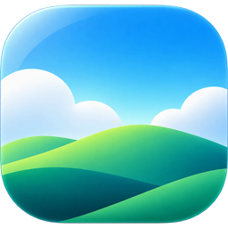
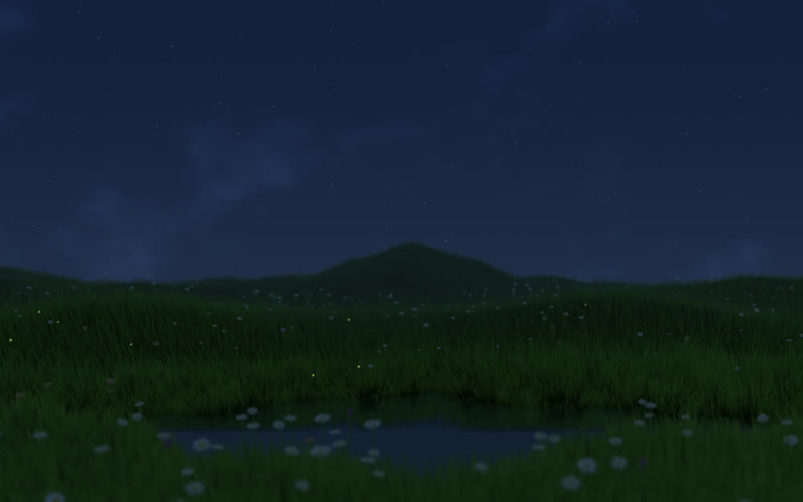

<p align="center">
  
</p>

<h1 align="center">SkySaver</h1>

<p align="center">
  A live wallpaper for Mac. The sky and a meadow follow the weather and the time of day in your city.
</p>

<p align="center">
  <a href="https://github.com/Thoufik001/skysaver/releases/download/builds/SkySaver.dmg"><b>Download for Mac</b></a>
  &nbsp;·&nbsp; macOS 13 or later &nbsp;·&nbsp; Apple silicon &nbsp;·&nbsp; Free
</p>

<p align="center">
  
</p>

SkySaver draws a meadow on your desktop, under a sky that matches your city: morning light, golden hour, rain, night. It runs from the menu bar and pauses when something covers the desktop.

<p align="center">
  
  
  
</p>

## Features

- Weather and sunrise and sunset come from your city, so the light and clouds follow what is outside. Choose another city any time.
- Move the pointer across the meadow and the grass bends. Turn this off in Settings if you want the sky to play on its own.
- Pauses when a full-screen app or a window covers the desktop.
- Optional ambient sound that follows the sky: wind, birds by day, a night soundscape, rain and thunder, with a volume slider.
- A time dial and a weather picker let you preview any hour and any weather.
- Runs on every display and every desktop.
- Starts at login if you want it to, and updates itself.

## Install

1. [Download SkySaver.dmg](https://github.com/Thoufik001/skysaver/releases/download/builds/SkySaver.dmg).
2. Open it and double-click SkySaver. It offers to move itself into Applications.
3. The first time you open it, macOS says it can't verify SkySaver, because the app isn't notarized yet. Click **Done**, open **System Settings → Privacy & Security**, scroll down and click **Open Anyway** next to SkySaver, then enter your password. You only need to do this once.

To skip the warning altogether, install from Terminal instead. Paste this one line:

```
curl -fsSL https://thoufik.space/skysaver/install.sh | bash
```

It downloads the same app and puts it in Applications. Because Terminal downloads aren't marked as coming from the internet, macOS opens it straight away. You can read the script first at [thoufik.space/skysaver/install.sh](https://thoufik.space/skysaver/install.sh).

Click the cloud-and-sun icon in the menu bar, then **Start Wallpaper**. **Stop Wallpaper** brings your usual wallpaper back.

## Settings

Open Settings from the gear in the menu bar card, from the sky window, or with ⌘,.

- Keep sound in other apps
- React to my pointer
- Start at Login
- Share anonymous usage
- Report a problem
- Version and updates

While SkySaver runs, your lock screen shows a still of the current sky. When you quit, your original wallpaper comes back.

## Updates

SkySaver checks for updates about once a day. When one is available, a small green dot appears on the menu bar icon, and the card shows **Update available** with an **Update now** button.

## Privacy

There is no account. SkySaver does not open your files, photos or documents.

If you allow location, it is used on your Mac to choose your city and compute the sky. You can skip it and pick a city by hand.

SkySaver sends anonymous usage counts by default: that the app was opened that day, whether the wallpaper is running right now, how long the wallpaper ran, which switches were used, the app version, and any crash or error it noticed. Your country is worked out by the server from your connection. No names, no IDs, no IP addresses are stored, and nothing you type is sent. Turn it off in Settings with **Share anonymous usage**.

The app talks to these services:

| Service | Used for |
| --- | --- |
| [Open-Meteo](https://open-meteo.com/) | Weather and sunrise and sunset |
| [aviationweather.gov](https://aviationweather.gov/) | Cloud observations near you |
| BigDataCloud | Turning your coordinates into a city name |
| This repository | Update checks |
| thoufik.space | Anonymous usage counts, unless turned off |

## Feedback

Use **Report a problem** in Settings. It opens a GitHub [issue](https://github.com/Thoufik001/skysaver/issues) with your app and macOS version filled in. Add what happened, and a screen recording helps.

SkySaver is made by [Thoufik Abdullah](https://thoufik-abdullah.vercel.app/). This repository hosts the downloads and the update feed. The source code is not public.

---

Weather data by [Open-Meteo.com](https://open-meteo.com/) ([CC BY 4.0](https://creativecommons.org/licenses/by/4.0/)).

© 2026 Thoufik Abdullah. All rights reserved. Please don't redistribute or resell SkySaver.
